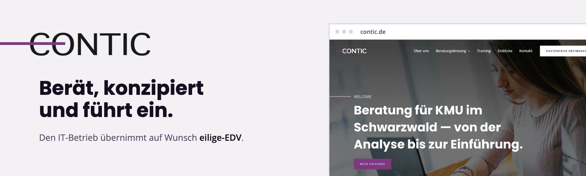

**Unternehmensberatung Schwarzwald** · Gengenbach · gegründet 2007

---

## Was wir tun

Für KMU, Freiberufler und Produktionsbetriebe in Baden-Württemberg:

- Unternehmens- und Technologieberatung
- Prozessautomatisierung
- Augmented Reality und IoT
- Cloud-Ausstieg
- Training und Schulung

→ Alle Leistungen: [contic.de](https://contic.de?mtm_source=github&mtm_medium=profil)

## Bereiche

| Bereich | Wofür | Wo |
| ------- | ----- | -- |
| **Beratung** | Konzeption, Einführung, Begleitung | [contic.de](https://contic.de?mtm_source=github&mtm_medium=profil) |
| **IT** | Operative IT: Cloud, Netzwerk und Server, Backup und Sicherheit, Helpdesk — der IT-Betrieb von CONTIC | [eilige-edv.de](https://eilige-edv.de?mtm_source=github&mtm_medium=profil) |
| **Bildung** | E-Business-Weiterbildung für Hochschulen, Bildungsträger und Unternehmen — eigene Organisation, Teil von CONTIC | [edu-space.de](https://edu-space.de?mtm_source=github&mtm_medium=profil) · [GitHub](https://github.com/edu-space-de) |

## Code und Beiträge

Öffentlich ist hier nur ein Teil unserer Arbeit; das meiste entsteht in
Kundenprojekten und ist nicht öffentlich. Eigene Werkzeuge entwickeln wir auf
einer selbst betriebenen Forgejo-Instanz und veröffentlichen hier das, was
anderen nützt.

<!-- Konkrete Repos und Beiträge hier ergänzen, sobald sie öffentlich sind (z. B. contic-kalender-sync). -->

## Kontakt

Website: <https://contic.de?mtm_source=github&mtm_medium=profil> · Impressum: <https://contic.de/impressum>

English

**CONTIC** is a business consultancy in the Black Forest (Gengenbach, Germany, founded 2007).
We advise, design and implement; ongoing IT operations are provided on request by
**eilige-EDV**. Education and training for universities and training providers: **EDU-SPACE**.
[contic.de](https://contic.de?mtm_source=github&mtm_medium=profil)

(<a href="#readme-top">nach oben</a>)

